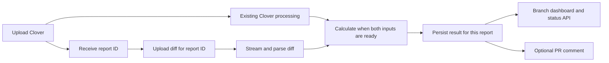

# Plan: Coverage of Changed Lines from Uploaded Diffs

## Context

Calculate coverage of changed executable lines for every received report using an extra CI-generated diff upload. The user selected locally generated, uploaded diffs instead of GitHub comparison APIs because large branches should not depend on API file limits or rate limiting. Keep CloverParser's existing behavior, add an independent diff parser and processing job, then calculate against the report's stored executable-line hit counts when both inputs are ready. PRs are optional presentation and never determine whether a report is calculated.

Implementation branch: `feat/uploaded-diff-coverage`, created from the planning branch at `47d5002`. The user approved all phases on 2026-10-14. Tasks are marked complete as implementation and validation finish.

## Confirmed Decisions

- The feature belongs to reports and branches. No PR is required.
- CI generates the diff using its checkout. CoverCraft parses the uploaded artifact itself.
- Add an extra upload associated with a specific coverage report.
- Preserve current Clover parsing and existing aggregate coverage.
- Add independent asynchronous diff processing and changed-line coverage calculation.
- Changed-line calculation must not call GitHub to obtain or reconstruct a diff.
- Each feature-branch diff covers the complete branch contribution since its merge base with the repository default branch. Repeated uploads continue to include earlier untested branch work.

## Product Behavior

**Changed-line coverage = covered changed executable lines / all changed executable lines × 100.**

A changed line is an addition on the uploaded diff's new side; a modified statement appears as a deletion/addition pair. Intersect those new-side line numbers with the same report's Clover statement entries. Hit count greater than zero means covered. Context, deleted lines, and lines without statement entries in a reported file do not enter the denominator. Sum counts across files before rounding.

Example: 20 added source lines include 10 executable statements, and 7 have hits. Show **70% · 7/10 changed executable lines covered · 3 uncovered**.

A complete, nonempty executable denominator with no hits means 0%. An empty executable denominator means “No executable changes” with a null percentage. An absent diff means “Diff not uploaded,” not 0%. Missing coverage for an eligible changed source file means an incomplete result rather than a guessed percentage.

A single head report and its diff are sufficient for changed-line coverage. Quantifying how existing coverage improved or regressed requires a separate baseline coverage report; that before/after feature is not implied by parsing a diff.

### Flow



The HTTP requests create the report first, but the queue jobs may finish in either order. The later-finishing input schedules calculation. Clover can remain completed if the diff is absent or invalid. Every successfully parsed report becomes eligible for automatic calculation once its diff has been accepted, including archived reports and duplicate commit uploads.

### Baseline

The diff producer must choose and report the actual comparison base. CoverCraft cannot infer that base from patch text or independently verify the source trees without consulting the repository.

Confirmed feature-branch policy: resolve the merge base between the uploaded head commit and the repository default branch in CI, then generate a two-tree diff from that base to the uploaded head. Include all branch changes on every upload, including untested lines introduced by earlier commits. Do not compare feature branches with their preceding uploaded reports.

Default-branch diffs compare with the uploaded commit's first parent. An initial root commit may use the empty Git tree as its explicit base. CI supplies resolved endpoints; the server does not fetch a baseline.

Upload the **effective base SHA** and **head SHA**. For a feature-branch comparison, the effective base is the resolved merge-base commit, not the current default-branch tip. The head must equal the report's declared commit. Label the saved result with the base, head, and baseline branch/type. No moving refs or PRs can change it after upload.

An authenticated CI upload attests to those SHAs and completeness. Matching metadata prevents accidental pairing but cannot prove that arbitrary patch bytes came from those trees. Explain this trust boundary; no server-side GitHub verification is planned.

## Existing Code and Evidence

- `CoverageController::store()` returns a unique `report_id`; attach the second upload to it instead of looking up the newest report by branch or commit.
- `CloverParser::parseFile()` already supplies repository paths, statement line numbers, and hit counts.
- `CoverageFile::lineCoverage()` exposes stored compressed line maps for calculation.
- `ProcessCoverageJob` persists parsed files and marks the report completed in a transaction. Add only a follow-up readiness check; preserve parser behavior.
- The existing upload-status API and team-token middleware can expose independent diff/calculation states and authorize attachment.
- `CleanupCoverageReports` can delete superseded branch reports; it must briefly protect received diffs or calculations in flight.
- `docker/php.ini` currently limits request bodies and individual uploads to 50M. Application limits must fit the deployment's effective body limits, including multipart overhead.
- Laravel Boost reports PHP 8.5, Laravel 13.36.0, and PHPUnit 13.4.2, matching Composer; AGENTS.md's package inventory is older. Preserve its conventions while using installed-version APIs.

Git supports zero-context unified diffs and controls for color, external diff drivers, and text conversion. These allow a consistent CI-generated patch format; see [git-diff documentation](https://git-scm.com/docs/git-diff). There is no GitHub comparison file cap in this approach. Our upload, decompression, memory, storage, and job limits remain deliberate resource limits.

## Trade-offs & Alternatives Considered

- **Uploaded Git diff versus GitHub APIs:** CI has repository history and can generate the complete artifact. Adds one upload and a baseline-generation step, while avoiding API comparisons.
- **A separate endpoint versus one multipart upload:** the requested extra upload preserves the existing Clover request and permits independent upload retries. Explicit report IDs avoid ambiguity across simultaneous runs.
- **Independent jobs versus one combined processor:** preserve existing Clover behavior and permit either input to complete first. Use a shared readiness check and idempotent calculation to handle races.
- **Streaming and ranges versus loading patch text into memory:** consume the file incrementally and retain changed line ranges, not source text, in the parsed index. Decode coverage for a bounded batch of files.
- **Raw diff retention versus derived data only:** temporarily retain the raw artifact for retries; keep a compact index for presentation and calculation. The retention policy remains a review question.
- **Optional diff versus required diff:** proposed first release preserves Clover-only uploads with a visible awaiting-diff state. Whether CI should be required to attach a diff remains to be decided.
- **Source eligibility:** Clover can omit files. A reliable missing-data policy needs a declared source scope rather than assuming absent paths are nonexecutable.

## Constraints

- Implement all approved tasks using project conventions, preserving existing Clover calculations.
- Follow existing typed Laravel services/jobs, Eloquent relationships, integer report IDs, factories, and PHPUnit conventions. Do not introduce dependencies or new base directories.
- Generate PHP artifacts through Artisan `make:* --no-interaction`; inspect help for supported options.
- All diff attachment, result reads, and report selection retain team authorization.
- Use the configured private coverage storage disk and unique artifact names. Never construct storage paths directly from diff filenames or apply uploaded patches to the filesystem.
- Keep HTTP upload work limited to validation, streaming storage, and scheduling. Parse in queued jobs.
- Keep raw source text out of parsed indexes, logs, and public responses. Render repository-controlled paths safely.
- Every implementation change receives meaningful affected tests; format PHP with `vendor/bin/pint --dirty --format agent`.
- Before UI implementation, locate/read the required Tailwind skill and consult installed-version documentation. Reuse current components and source-viewer styling.
- This authorized plan is the only documentation artifact until another is requested.

## Tasks

### Phase 1: Define and Store the Diff Upload Contract

- [x] Extend `coverage_reports` through `database/migrations/YYYY_MM_DD_HHMMSS_add_diff_upload_to_coverage_reports_table.php`, generated by Artisan. Proposed columns:

  ```php
  $table->string('diff_file_path')->nullable();
  $table->string('diff_index_path')->nullable();
  $table->char('diff_sha256', 64)->nullable();
  $table->char('diff_base_sha', 40)->nullable();
  $table->string('diff_status')->nullable();
  $table->string('diff_error_code')->nullable();
  $table->json('diff_metadata')->nullable();
  $table->json('patch_coverage')->nullable();
  ```

  The report already supplies head SHA. SHA-1 validation matches the current 40-character upload contract; supporting other object formats is a separate change. No foreign key to a baseline report is necessary. Existing reports stay nullable and receive no automatic backfill.

- [x] Add casts/fillable fields in `app/Models/CoverageReport.php`. New reports initialize `diff_status = awaiting_upload`; legacy null means not requested. Diff states: `awaiting_upload`, `queued`, `processing`, `completed`, `failed`. Calculation states in patch_coverage: `awaiting_diff`, `awaiting_coverage`, `pending`, `completed`, `no_executable_changes`, `incomplete`, `unavailable`.

  ```php
  'diff_metadata' => 'array',
  'patch_coverage' => 'array',
  ```

  Keep Clover `status`, diff_status, and calculation status independent. A failed diff never marks completed Clover as failed.

- [x] Create `app/Http/Requests/StoreCoverageDiffRequest.php` and `app/Http/Controllers/CoverageDiffController.php` via Artisan. Proposed authenticated route in `routes/api.php`:

  ```php
  Route::post('/coverage/{report}/diff', [CoverageDiffController::class, 'store'])
      ->name('api.coverage.diff.store');
  ```

  Multipart fields: `diff_file`, `base_commit_sha`, `head_commit_sha`, optional `base_branch` and `comparison_type`, plus artifact checksum/count metadata if the completeness contract adopts it. Validate with a Form Request and custom messages. Assert head_commit_sha equals the selected report's commit and the token's team owns that report. Archived report IDs are valid attachment targets while retained.

  Return 202 with report_id, diff_status, and patch calculation state after streaming to a private UUID-based artifact path. Storage rejection returns a readable error and persists no accepted artifact. Preserve `/api/coverage` fields and its existing response.

- [x] Define upload retry/replacement semantics before implementation: identical artifact and metadata should be idempotent, not create duplicate jobs. A different diff must not silently overwrite a result while an earlier job is running. Proposed first version accepts one artifact per report and rejects a conflicting second upload with 409; correction/replacement behavior remains an interview decision.

- [x] Add states to `database/factories/CoverageReportFactory.php`; create/run `tests/Feature/Api/CoverageDiffApiTest.php` and update/run `tests/Feature/Models/CoverageReportTest.php`. Cover same-team attachment, cross-team denial, missing report, archived reports, head mismatch, malformed SHA, request limits, storage failures, duplicate uploads, empty-diff behavior, and conflicting artifacts.

### Phase 2: Standardize CI Diff Generation and Large-Artifact Handling

- [x] Agree on a machine-readable Git patch convention. Proposed generation for already resolved immutable SHAs:

  ```sh
  git diff --find-renames --no-color --no-ext-diff --no-textconv --unified=0 --src-prefix=a/ --dst-prefix=b/ BASE_SHA HEAD_SHA -- > changes.diff
  ```

  BASE_SHA and HEAD_SHA above are placeholders for actual resolved commit IDs. For feature branches, resolve BASE_SHA as the merge base with the default branch and HEAD_SHA as the commit used for Clover. Generate from those committed trees, rather than dirty working-tree or synthetic merge output from a different revision. CI must fetch enough history to resolve the merge base. Default-branch and initial-root-commit handling remain product decisions.

  Preserve standard rename metadata; pure renames have no new executable lines, while changed renamed files use head paths. Reject combined merge diffs; generate a conventional two-tree patch even for merge commits. Include headers for binary/mode-only changes so the parser can distinguish them from missing text changes.

- [x] Accept plain Git unified diff and, provisionally, gzip-compressed diff. Determine encoding from the agreed contract and verified file signature, not just its extension. Empty diffs are valid artifacts for identical trees; ensure upload validation can represent them, for example an uploaded gzip file whose decompressed content is empty.

  Stream decompression and parsing; enforce separate compressed-upload and decompressed-byte limits, plus bounded line length and per-file/hunk counts. Reject exceeding limits explicitly instead of truncating. Select exact default limits with a representative large-branch artifact during implementation/review; no unbounded promise is made by the upload design.

- [x] Agree on completeness metadata. Hunk length checks detect partial hunks, but cannot detect an entire omitted final file. Recommended CI metadata includes independent file/addition/deletion counts from Git for the same endpoints, and artifact checksum/byte count. Verify it while parsing. Scope exclusions must be stated so the counts refer to the entire generated artifact, not a different file subset. Authenticated CI remains responsible for truthful and complete generation.

- [x] Add compression, incomplete artifact, unusual filename, empty file, long-line, large-file-count, and byte-limit cases to `tests/Feature/Api/CoverageDiffApiTest.php` and the parser tests below. Use deterministic fixtures; do not benchmark network or GitHub access for this feature.

### Phase 3: Parse and Index the Diff Independently

- [x] Create `app/Services/UnifiedDiffParser.php` via Artisan with a streaming contract:

  ```php
  /** @return Generator<int, array{path: string, previous_path: ?string, kind: string, added_ranges: list<array{start: int, end: int}>, additions: int, deletions: int}> */
  public function parseFile(string $filePath, string $encoding): Generator;
  ```

  Parse file headers, `/dev/null`, quoted/escaped Git paths, rename metadata, mode changes, binary markers, and unified hunk headers. Maintain old/new cursors per hunk. Record only added head-line ranges; deleted/context lines and the no-final-newline marker never become added lines. Validate hunk lengths and ordering. Source lines beginning with `+`, `-`, or header-like text are interpreted within their current hunk, not as new files.

  Yield one file at a time. Reject malformed/unsupported input and report meaningful reason codes. A valid empty diff yields no files. No shell execution, patch application, checkout, or repository fetch occurs in this parser.

- [x] Create `app/Jobs/ProcessCoverageDiffJob.php` with promoted report ID and artifact identity:

  ```php
  public function __construct(public int $coverageReportId, public string $artifactSha256) {}
  public function handle(UnifiedDiffParser $parser): void;
  public function failed(Throwable $exception): void;
  ```

  Confirm the job still owns the accepted artifact, mark diff processing, stream normalized file/range records to a temporary JSONL index on the private coverage disk, then atomically publish the complete index and completed status. Save parser/count summaries in diff_metadata. Partial indexes must not be consumed. Duplicate deliveries reuse a completed index for the same artifact.

  On failure set only diff/calculation failure state, retaining aggregate coverage. Retry transient storage errors; malformed data is terminal. After successful indexing, schedule the readiness check for calculation.

- [x] Create/run `tests/Unit/Services/UnifiedDiffParserTest.php` and `tests/Feature/Jobs/ProcessCoverageDiffJobTest.php`. Verify exact ranges, multiple hunks/files, renamed and new files, deletion-only changes, omitted/zero counts, binary and mode-only files, Git path quoting, no-final-newline markers, malformed/truncated hunks, complete-count disagreements, gzip corruption, streaming limits, empty artifacts, duplicate jobs, and incomplete index isolation.

### Phase 4: Calculate Once Both Inputs Are Ready

- [x] Create `app/Actions/QueueChangedLineCoverageAction.php` with:

  ```php
  public function execute(CoverageReport $report): void;
  ```

  Re-read states after input transactions commit. If Clover and the parsed diff are completed, atomically mark calculation pending and dispatch `CalculateChangedLineCoverageJob::dispatch($report->id)->afterCommit()`. Otherwise save the appropriate awaiting-input state. Duplicate readiness checks and jobs must be harmless. Handle a dispatch interruption through an idempotent repeated readiness check; do not rely only on a one-time state transition that can lose queued work.

- [x] Call this action after `ProcessCoverageJob` finishes and after `ProcessCoverageDiffJob` publishes its index. Preserve CloverParser and ProcessCoverageJob's existing report/file calculations. Original PR-comment scheduling can remain independent and later refresh once changed-line data is ready.

- [x] Create `app/Services/PatchCoverageCalculator.php` and `app/Jobs/CalculateChangedLineCoverageJob.php` via Artisan. Proposed calculator contract:

  ```php
  public function calculate(CoverageReport $report): array;
  ```

  Stream the parsed file index and query report files by a bounded batch of paths using the report's Eloquent relationship. Decode each file's coverage map only when processing it. Avoid one query per file and loading the whole raw diff, all coverage maps, or every changed line number simultaneously. Match repository-relative head paths exactly; do not guess by basename.

  Intersect added ranges with stored statement line numbers, count hits, and retain compact changed/uncovered ranges for navigation. Sum integer counts and calculate the percentage after traversal. Persist a versioned snapshot with head/base, artifact identity, scope, counts, per-file summaries, and readable states. Store large line indexes privately and keep API responses compact.

  Missing eligible source coverage produces incomplete rather than a guessed total. A reported file with no executable additions contributes zero denominator. Binary source paths need an explicit unsupported/incomplete policy; non-source binary paths can be excluded. Source eligibility/exclusion defaults remain a review question.

  Use per-report overlap protection and artifact identity checks before publishing. Failures stay independent of Clover/diff success. Completed archived reports remain valid. Calculation makes zero GitHub API calls.

- [x] Update `CleanupCoverageReports` to protect accepted diff artifacts and pending processing for a bounded grace period, then delete raw/index artifacts with their owning report under the existing shared-path precautions. Awaiting-upload reports cannot be protected indefinitely. Choose raw-artifact retention and grace duration during review; derived results are owned by report retention.

- [x] Create/run `tests/Feature/Actions/QueueChangedLineCoverageActionTest.php`, `tests/Feature/Services/PatchCoverageCalculatorTest.php`, and `tests/Feature/Jobs/CalculateChangedLineCoverageJobTest.php`; update/run `tests/Feature/Jobs/ProcessCoverageJobTest.php` and `tests/Feature/Console/CleanupCoverageReportsTest.php` after edits.

  Cover Clover-first/diff-first ordering, concurrent readiness checks, archived and duplicate reports, 0% versus no executable changes, weighted totals, missing files, path mismatch, source exclusions, malformed line data, bounded batching, publish interruption/retries, no GitHub access, processing failure independence, and cleanup races.

### Phase 5: Display Results and Validate the Complete Flow

- [x] Extend `CoverageController::status()` with independent diff and changed-line states, preserving existing Clover fields and token authorization. Return base/head/count summaries and readable reasons, not raw patch content or huge line arrays.

- [x] Add `resources/views/components/patch-coverage-summary.blade.php` and use it in `resources/views/dashboard/branch.blade.php`. Show the calculation, raw counts, chosen baseline, changed source files, and waiting/invalid/incomplete states. Keep whole-project coverage differences accurately labeled as a separate metric.

- [x] Extend `DashboardController::branch()` and `file()` with authorized `?report=ID` selection through the repository and branch. Propagate it through file links, toggles, and navigation. A specific report's source viewer uses its uploaded commit and stored changed ranges. Do not merge a newer branch file cache into its historical file tree.

- [x] Update `resources/views/dashboard/file.blade.php` and `resources/js/app.js` to mark changed lines and navigate to the next uncovered changed line. Preserve existing source whitespace and uncovered-line navigation. Use accessible markers alongside color.

- [x] Let `PullRequestCommentService` consume saved results. Clover-only PR comments may show awaiting diff; successful calculation schedules a refresh through the existing optional comment job. A stale PR head suppresses old comment publication, but never invalidates a report's branch result or triggers recalculation. Show the chosen branch baseline even if it differs from the PR target.

- [x] Create/run `tests/Feature/Dashboard/PatchCoverageTest.php`; update/run `tests/Feature/Api/CoverageApiTest.php`, `tests/Feature/Dashboard/DesignConsistencyTest.php`, `tests/Feature/Services/PullRequestCommentServiceTest.php`, and `tests/Feature/Jobs/PostPullRequestCommentJobTest.php` as edited.

- [x] Extend/run `tests/Feature/Integration/CoverageWorkflowTest.php` with an extra-upload flow without a PR, both input completion orders, two reports from one branch paired by ID, invalid diff preserving valid Clover, empty diff, and an optional PR refresh. Assert exact counts and consistent artifact/base/head identities across surfaces.

- [x] Run affected tests with explicit files, `vendor/bin/pint --dirty --format agent`, `npm run build` if frontend files changed, and `git diff --check`. Use a representative large diff to verify bounded memory and configured request/job limits. Offer the full test suite after targeted checks pass, as required by AGENTS.md.

## Approved Implementation Defaults

- Default-branch baseline: first parent; feature branches: merge base with default branch.
- Optional diff upload preserves existing clients; plain and gzip artifacts accepted, including empty diffs.
- Required metadata: base/head SHA, artifact SHA-256, file count, addition count, deletion count. Counts include the complete diff, including binary/rename records (binary additions/deletions are zero).
- One immutable artifact per report; identical retries are idempotent and conflicting uploads return 409.
- Source scope: PHP files, excluding tests, Blade templates, and existing global exclusions; snapshot scope with the accepted artifact. Missing eligible source coverage produces an incomplete result.
- Configurable defaults: 45 MiB uploaded, 256 MiB decompressed, 1 MiB line length, 100,000 files, 1,000,000 hunks, 60-second jobs, 30-minute processing grace. Raw/index artifacts follow report retention.
- Compact indexes use JSONL file records with ranges; summary JSON is bounded by configured file limits. No new dependencies.
- The skill checks.sh script has no frontend commands matching this repository. Use its PHP checks plus the repository's npm run check/build/test for JavaScript; no TypeScript is added.

## Implementation Notes

- Summary responses and dashboard tables retain the first 100 measured files; totals include every measured file. PR tables show the first 25. The private streamed index supports changed-line navigation for any report file.
- A per-file range cap of 10,000 bounds sparse-file parser memory alongside the total byte/file/hunk limits.
- Malformed report selectors use Form Request validation; missing or cross-repository/branch report IDs return 404.
- The bundled Tailwind skill was found at vendor/laravel/boost/.ai/tailwindcss/4/skill/tailwindcss-development/SKILL.md and applied without installing anything.

- Calculation batches default to 25 paths and cap decompressed coverage maps at 4 MiB per file. Oversized or invalid maps make the result incomplete instead of risking a worker memory failure.
- Parsed paths are limited to 4,096 UTF-8 bytes; duplicate-path detection retains fixed-size SHA-256 keys rather than all path bytes.

## CI Upload Example

After uploading Clover, export `COVERCRAFT_REPORT_ID` from its response, together with `COVERCRAFT_URL`, `COVERCRAFT_TOKEN`, `COVERCRAFT_DIFF_BASE_SHA`, and `COVERCRAFT_DIFF_HEAD_SHA`. The head must be the commit used for the coverage run. Resolve the feature-branch base with `git merge-base` against the default branch; on the default branch use the head's first parent. Set optional `COVERCRAFT_DIFF_BASE_BRANCH` and `COVERCRAFT_DIFF_COMPARISON_TYPE` (`merge_base`, `first_parent`, or `initial`) to label the result.

Run this in the CI checkout with sufficient fetched history. It generates a zero-context diff, compresses it, derives complete counts from Git's NUL-delimited numstat (including rename and binary records), and uploads the artifact to the existing report:

```python
import gzip
import hashlib
import os
import shutil
import subprocess

base = os.environ['COVERCRAFT_DIFF_BASE_SHA']
head = os.environ['COVERCRAFT_DIFF_HEAD_SHA']
git_args = ['git', 'diff', '--find-renames', '--no-ext-diff', '--no-textconv']
with open('changes.diff', 'wb') as output:
    subprocess.run(git_args + ['--no-color', '--unified=0', '--src-prefix=a/',
                   '--dst-prefix=b/', base, head, '--'], stdout=output, check=True)
with open('changes.diff', 'rb') as source:
    with gzip.GzipFile('changes.diff.gz', 'wb', mtime=0) as output:
        shutil.copyfileobj(source, output, length=1024 * 1024)

stats = subprocess.run(git_args + ['--numstat', '-z', base, head, '--'],
                       stdout=subprocess.PIPE, check=True).stdout.split(b'\0')
counts = {'file_count': 0, 'added_lines': 0, 'deleted_lines': 0}
position = 0
while position < len(stats) and stats[position]:
    added, deleted, path = stats[position].split(b'\t', 2)
    counts['file_count'] += 1
    counts['added_lines'] += 0 if added == b'-' else int(added)
    counts['deleted_lines'] += 0 if deleted == b'-' else int(deleted)
    position += 3 if not path else 1

digest = hashlib.sha256()
with open('changes.diff.gz', 'rb') as source:
    for chunk in iter(lambda: source.read(1024 * 1024), b''):
        digest.update(chunk)
fields = dict(counts, base_commit_sha=base, head_commit_sha=head,
              sha256=digest.hexdigest())
for field, variable in [('base_branch', 'COVERCRAFT_DIFF_BASE_BRANCH'),
                        ('comparison_type', 'COVERCRAFT_DIFF_COMPARISON_TYPE')]:
    if os.environ.get(variable):
        fields[field] = os.environ[variable]
url = os.environ['COVERCRAFT_URL'].rstrip('/')
url += '/api/coverage/' + os.environ['COVERCRAFT_REPORT_ID'] + '/diff'
command = ['curl', '--fail-with-body', '--silent', '--show-error',
           '--header', 'Accept: application/json',
           '--header', 'Authorization: Bearer ' + os.environ['COVERCRAFT_TOKEN'],
           '--form', 'diff_file=@changes.diff.gz']
for field, value in fields.items():
    command += ['--form-string', field + '=' + str(value)]
subprocess.run(command + [url], check=True)
```

## Validation Results

- 185 affected PHP tests passed (10,690 assertions), including API, both job orderings, archived reports, source-viewer regression checks, and cleanup.
- Full PHP suite passed after rebasing onto the latest main branch: 395 tests (17,190 assertions). The initial sandbox run encountered OpenSSL random-state write restrictions in 18 existing GitHub App tests; rerunning with normal filesystem access resolved them.
- Four frontend tests passed; npm run check and npm run build passed.
- The large compressed-branch test parsed 10,000 files / 1,000,000 added lines with under 16 MiB additional parser memory (whole test process peaked around 50 MiB).
- Laravel Pint and whitespace checks passed. No dependencies changed. The new migration is included and exercised by SQLite test migrations; it has not been applied to the configured application database.
- No browser automation tool was connected; rendered HTML/DOM assertions and tested Alpine navigation cover the new presentation behavior.
